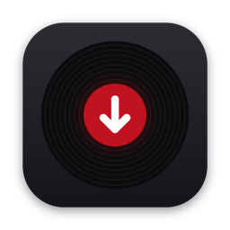

  

<h1 align="center">Les projets de GATØR</h1>

  Des outils de DJ faits maison pour préparer sa musique avant de mixer. 
  Volume calé d'un morceau à l'autre · classement par genre · bibliothèques prêtes pour Rekordbox

  

---

## Comment ça marche

**1. Demande l'accès**
Clique sur le bouton ci-dessus, choisis le projet et laisse-moi un petit mot si tu veux. Puis **Submit new issue**.
Il faut être connecté à GitHub : pas de compte ? Il est gratuit et se crée en une minute sur [github.com/signup](https://github.com/signup).

**2. Reçois l'invitation**
Quand j'accepte, une invitation arrive dans tes mails. Clique sur **Accept invitation**.

**3. Installe**
Tu as maintenant accès au projet : suis son guide d'installation, il tient en quelques étapes.

---

## À savoir

Ce sont des projets personnels, **privés**, partagés entre amis sur demande. Chacun les utilise avec ses propres comptes
et abonnements.

## Une question ?

Écris-moi sur Instagram : **[@gator_dj](https://www.instagram.com/gator_dj)**
